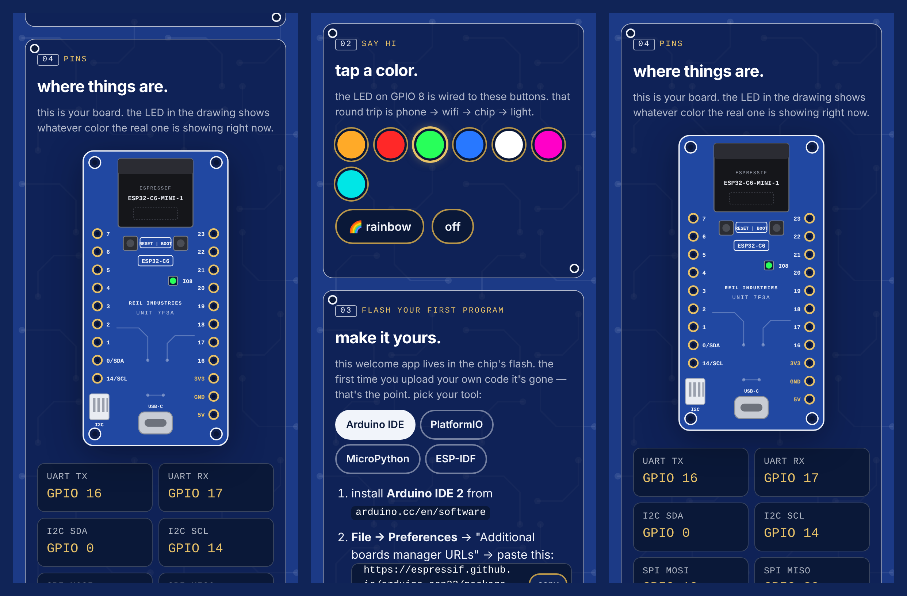
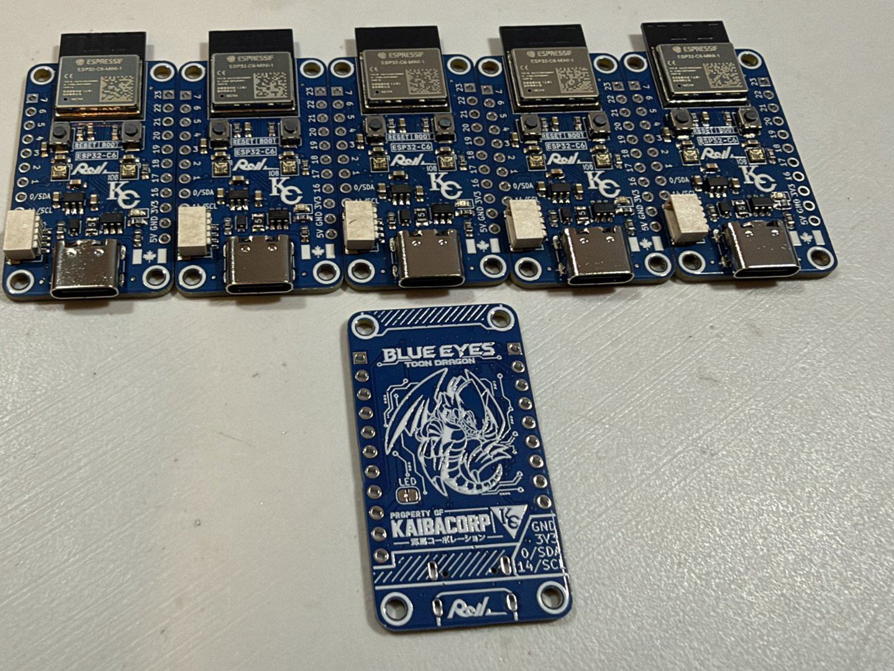

# willreil-welcome

**it's alive.** — a welcome app that lives on every ESP32-C6 you ship. themed like the board: blue soldermask, white silkscreen, gold pads.

plug the board in → it broadcasts its own wifi (`Reil-7F3A`) → the buyer joins with the password on the card → their phone pops the "sign in to network" sheet, hotel-wifi style → that sheet *is* this app, served straight from the chip. no internet needed, no app store, nothing to install.





*the boards: ESP32-C6-MINI-1, RESET | BOOT, LED on IO8, left header 7…1 then 0/SDA · 14/SCL, right header 23…16 then 3V3 · GND · 5V, I2C with a Qwiic jack. the page is themed after them.*

## what the buyer sees

| section | what it does |
|---|---|
| **vitals · live** | chip, cores, MHz, flash, RAM, die temperature, uptime, who's connected, MAC, core + IDF versions. polls every 3 s. the dot goes red if the board drops. |
| **say hi** | color swatches, rainbow, off — wired to the onboard LED. phone → wifi → chip → light. that's the "oh, it's real" moment. |
| **flash your first program** | tabbed, step-by-step: Arduino IDE (board URL with a copy button, `ESP32C6 Dev Module`, USB CDC On Boot, Blink), PlatformIO (pioarduino), MicroPython, ESP-IDF. plus the "stuck on Connecting…" fix. |
| **pins** | a labeled drawing of the board (the LED in it mirrors the real one's color), plus UART / I2C / SPI / BOOT / LED pins reported **by the firmware itself** — the core's defaults, overridden by `BOARD_SDA` / `BOARD_SCL` so the page says `0/SDA · 14/SCL` like the silkscreen does. Qwiic note and strapping-pin warning included. |
| **this wifi** | buyer can set their own password (saved to NVS, board restarts). hold BOOT 5 s → back to the card password. |
| **stop the sign-in popup** | tells their phone the "sign-in" is done so it stops nagging; they stay connected and can revisit `http://4.3.2.1` any time. |

## what you do (per board, about 20 seconds)

1. flash `willreil_welcome.ino` (same firmware on every board — nothing to edit per unit)
2. open Serial Monitor @ 115200, press RESET (or type anything + Enter). the board prints:
   ```
   SSID : Reil-7F3A
   PASS : 7K3M-9PXZ
   ```
3. write those two lines on the card that goes in the box. done.

or let `ship.py` do it:

```
pip install esptool pyserial
python ship.py            # flashes the exported .bin, reads the label off the board, prints it, logs it to labels.csv
```

(`labels.csv` holds every unit's password — it's git-ignored on purpose. keep it on the bench machine.)

## how passwords work

every board derives its own password from `sha256(UNIT_SECRET + factory MAC)` → 8 characters from an alphabet with no `0/O/1/I` confusion, split `XXXX-XXXX`. same firmware, different password per card, no database.

- **change `UNIT_SECRET` once** before your first batch, then never again — old cards stop matching if you do.
- want one password for everything instead? `#define PER_UNIT_PASSWORD 0` and set `FIXED_PASSWORD`.

## build

- Arduino IDE 2.x with the **esp32 by Espressif Systems** core, version **3.x** (the C6 doesn't exist in 2.x)
- Tools → Board → **ESP32C6 Dev Module**
- Tools → USB CDC On Boot → **Enabled**
- no libraries to install — everything used ships inside the core (WiFi, DNSServer, WebServer, ESPmDNS, Preferences, mbedtls)

for `ship.py`: Sketch → **Export Compiled Binary** once, and it'll find the `*.merged.bin` in `build/`.

## config

everything you'd ever touch is the block at the top of the `.ino`:

| define | what |
|---|---|
| `BRAND` | shown in the eyebrow + serial banner |
| `SSID_PREFIX` | network name prefix (`Reil` → `Reil-7F3A`) |
| `HOSTNAME` | `http://reil.local` |
| `CONTACT_X` / `CONTACT_SITE` / `CONTACT_EMAIL` | footer. `""` hides one. |
| `PER_UNIT_PASSWORD`, `FIXED_PASSWORD`, `UNIT_SECRET` | see above |
| `BOARD_SDA`, `BOARD_SCL` | what the silkscreen says (0 / 14 on these boards). `-1` = the core's default. |
| `LED_MODE`, `LED_PIN`, `LED_ACTIVE_LOW`, `LED_BRIGHTNESS` | `LED_MODE_AUTO` trusts the C6 devkit variant (WS2812 on GPIO 8). if your board puts the LED elsewhere, pick `LED_MODE_RGB` or `LED_MODE_PLAIN` + the pin. |
| `AP_CHANNEL`, `AP_MAX_CLIENTS` | wifi |

the page itself is `willreil_welcome/portal.h` — plain HTML/CSS/JS in one string, edit the copy however you like. (it lives in its own file because the Arduino IDE scans `.ino` files for C++ prototypes and trips over the JavaScript.)

## how it works

- AP at `4.3.2.1`; the DNS server answers every lookup with that address, so any `http://` URL a phone tries lands on the board (`https://` can't, by design — there's no internet to get a certificate from)
- the OS connectivity probes (`/generate_204`, `/hotspot-detect.html`, `/connecttest.txt`, …) get a redirect to the page — that's what triggers the sign-in sheet. once a device taps "stop asking", those probes get the real answers each OS expects, and the nagging stops
- the page is a single HTML string in flash; `/api/status` is JSON built on the chip, `/api/led`, `/api/setpass`, `/api/resetpass`, `/api/release` are the four POSTs
- one `.ino`, zero external libraries, zero network dependencies

## license

MIT — put it on anything you sell.
